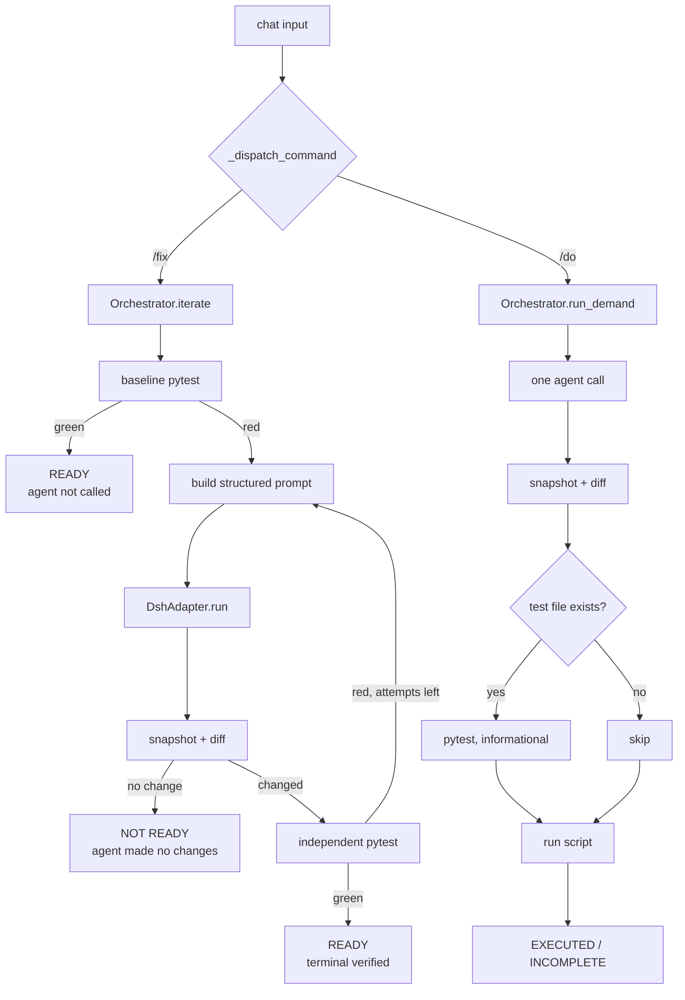

+++
title = "Architecture"
date = "2026-11-04"
draft = false
weight = 140
+++

The design is a separation of concerns, and the separation is the point.



## The rule

> **Pane 1 fixes. Panes 3 and 4 verify.**

The agent produces edits. It does not produce verdicts. Every green result in the
terminal comes from a process the agent does not control.

This matters because a model's self-report is unreliable in both directions: it
claims success when the change is wrong, and it sometimes succeeds without noticing.
Treating its summary as evidence makes the tool useless as an authority. Treating it
as a work proposal, then checking independently, makes it valuable.

## Modules

| Module | Responsibility |
| :--- | :--- |
| `app.py` | Textual UI, panes, command dispatch, background workers |
| `orchestrator.py` | Iteration policy: baseline, prompt construction, attempt cap, verification |
| `dsh_adapter.py` | Bridge to the harness: subprocess, line streaming, defensive parsing |
| `runner.py` | Structured execution of pytest and scripts |
| `watcher.py` | File snapshots and unified diffs |
| `state.py` | Cross-process JSON state for multi-window mode |
| `config.py` | Configuration resolution |

## The adapter boundary

`DshAdapter` runs:

```python
argv = [*prefix, "--profile", profile, prompt]
```

No `--json`, no `--model`, no `--provider` — current headless builds accept only the
profile and the task text. The adapter resolves `dsh` from PATH, falling back to
`npx --yes @deepseek-ai/dsh` if only npx is available.

Output is read line by line and parsed **defensively**:

```python
try:
    data = json.loads(text)
except json.JSONDecodeError:
    return {"kind": "raw", "text": text}
```

A line that is not JSON becomes raw text and streams into pane 1 unchanged. This is
what lets the tool survive a preview runtime whose output shape changes between
releases. Structured events are a bonus, not a dependency.

The subprocess is launched with `asyncio.create_subprocess_exec` and both streams
drained concurrently, so stderr reasoning and stdout output interleave without
deadlocking on a full pipe buffer.

## The structured failure

The single most important quality decision: **never hand the agent raw pytest output.**

`Runner._parse_pytest` extracts:

```json
{
  "ok": false,
  "exit_code": 1,
  "summary": {"passed": 5, "failed": 1},
  "failures": [
    {"name": "test_index_notes_handles_capitalised_title",
     "message": "KeyError: 'Title'"}
  ],
  "stdout_tail": "..."
}
```

Roughly 2 KB instead of 40 KB. The agent sees the failure signal without the noise,
which means it spends its context on the fix rather than on parsing pytest's
formatting.

Failures are parsed from `FAILED` and `ERROR` lines, deduplicated by test name. If
pytest is absent, the runner falls back to `unittest`.

## The iteration policy

`Orchestrator.iterate()` implements:

1. Baseline test run. Green means stop — there is nothing to fix.
2. Snapshot the target before the agent runs.
3. Build the prompt: system preamble, target path, attempt number, structured failure.
4. One adapter call.
5. Snapshot again. **No change means stop** — the agent talked but did not act, and
   retrying the same prompt will produce the same non-action.
6. Independent test run. This is the verification step.
7. Green means done. Red and attempts remain means loop with the new failure.

The cap (`--max-attempts`, default 4) exists because a confused agent can otherwise
burn an unbounded number of turns on the same wrong hypothesis.

## The demand path

`Orchestrator.run_demand()` is deliberately simpler:

1. Snapshot.
2. One adapter call with a demand-only prompt.
3. Diff and emit.
4. Run tests **if the file exists** — informational, not a gate.
5. Run the script as a smoke check.

No loop, because there is nothing to loop toward. Without a test there is no success
criterion, so iterating would just be the agent grading itself repeatedly.

This is why the verdict is `EXECUTED` rather than `READY`. The word `READY` is
reserved for a test that actually passed.

## Threading

Textual workers run on background threads; UI updates go through
`call_from_thread`. Workers are grouped:

```python
@work(thread=True, exclusive=True, group="iterate")
```

`exclusive=True` cancels a previous run in the same group, so hammering `/fix` does
not stack agent calls. Different groups can run concurrently — which is why you
should not fire `/do` while `/fix` is running against the same file.

## State

Two kinds:

**Per-process**, in memory: the current snapshot, used for diffing.

**Cross-process**, in `.cyberdeck/state.json`: chat transcript, last test result,
last run result. This is what lets four separate terminal windows (or tmux panes)
behave as one environment, and it is where you read the agent's output when
selecting text in the TUI is awkward.

Writes are atomic: write to `.tmp`, then `replace`.

## What is not here

No database. No server. No ports. The agent runs as a subprocess that exits when
the task is done, and the terminal holds all state in a JSON file you can read.

That is a deliberate trade. It means no concurrent multi-user access, no remote
dashboard, and no history beyond one JSON file. It also means the whole thing starts
in under a second and has no operational surface to maintain.